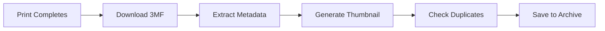

# Архивация печати {#print-archiving}

Bambuddy автоматически архивирует каждую печать с полными метаданными, 3D-предпросмотром и обнаружением дубликатов.

{ .screenshot }

---

## :material-archive: Как работает архивация {#how-archiving-works}

!!! warning "Необходима SD-карта"
    Для архивации в принтер должна быть вставлена SD-карта. После завершения каждой печати Bambuddy скачивает с неё файл 3MF.

Когда печать завершена:



### Что сохраняется в архиве {#what-gets-archived}

| Данные | Описание |
|------|-------------|
| **Файл 3MF** | Полный файл печати с принтера |
| **Миниатюра** | Изображение предпросмотра из слайсера |
| **Метаданные** | Настройки печати, слои, филамент и т. д. |
| **Результат печати** | Успешно, неудачно или остановлено |
| **Длительность** | Фактическое время печати |
| **Расход филамента** | Израсходованные граммы |
| **Снимок камеры** | Фото по завершении, если функция включена |

### Что пропускается {#what-gets-skipped}

Bambuddy автоматически пропускает архивацию для:

- **Калибровочных печатей** — внутренних операций принтера, например калибровки потока, компенсации вибрации и выравнивания стола (файлы gcode в `/usr/` на принтере)
- **Печатей с выключенной автоархивацией** — настройка **Настройки → Общие → Настройки архива → Автоматически архивировать печати** выключает её для всех принтеров. Пока она включена, действует отдельный переключатель в настройках каждого принтера. Это относится к печатям, запущенным вне Bambuddy; отправленные из Bambuddy по-прежнему архивируются

### Загрузка вручную перетаскиванием {#manual-upload-via-drag-and-drop}

Перетащите файлы `.3mf` в любое место страницы архива, чтобы загрузить их напрямую: откроется окно с уже выбранными файлами. Для файлов другого типа появится уведомление о поддержке только `.3mf`. Подсветка снимается автоматически при отмене: перетащите файлы обратно за пределы окна браузера, нажмите Escape во время перетаскивания или отпустите за пределами страницы, чтобы вернуться к обычному виду без обновления.

---

## :material-cube-scan: 3D-предпросмотр G-code {#3d-gcode-preview}

Нажмите **значок 3D-предпросмотра** (слои) на карточке архива или пункт **3D-предпросмотр** контекстного меню, чтобы открыть просмотр G-code. Траектория инструмента отображается тем же механизмом, что использует OrcaSlicer: экструдированные линии представлены объёмными телами и перекрывают друг друга, как в настольном слайсере. Так можно подробно изучить действия принтера, не выходя из приложения.

### Открытие просмотра {#opening-the-viewer}

- **Значок карточки** — нажмите значок слоёв в правом нижнем углу карточки
- **Контекстное меню** — щёлкните архив правой кнопкой → **3D-предпросмотр**
- **Меню в списке** — работает так же в компактном представлении

Просмотр открывается в основной области с видимой боковой панелью Bambuddy. После перезагрузки страницы он остаётся в интерфейсе: URL содержит ссылку на архив, поэтому просмотр восстанавливается.

### Выбор пластины {#plate-picker}

Для файла 3MF с несколькими пластинами сначала появляется окно выбора:

- **Сетка** — миниатюры пластин из слайсера, на широком экране в двух столбцах
- **Списки объектов** — в строке показаны первые несколько названий объектов пластины и время печати
- **Прокрутка** — архивы с десятками пластин прокручиваются внутри окна, не выходя за пределы страницы

Архивы с одной пластиной открываются сразу, без выбора.

В заголовке просмотра есть **переключатель пластин**, позволяющий переходить между ними без возврата к выбору. Текущая пластина входит в URL, поэтому ссылка на конкретную пластину продолжает работать и после перезагрузки. Нарезанные файлы из **Файлового менеджера** открываются в том же просмотрщике, но без окна выбора: сначала показывается первая пластина, остальные выбираются в заголовке.

### Управление просмотром {#viewer-controls}

- **Окраска по** — четыре способа отображения одной траектории:
    - **Филамент** (по умолчанию) показывает цвета, назначенные при нарезке; многоцветная модель выглядит как готовая печать.
    - **Тип линии** окрашивает стенки, разреженное и сплошное заполнение, мосты, поддержки, юбку, заполнение зазоров, глажение и башню очистки разными цветами из палитры слайсера.
    - **Высота** и **Ширина** окрашивают траекторию по шкале, чтобы заметить переменную высоту слоя или неожиданно тонкую стенку.
- **Скрытие лишнего** — каждый элемент легенды служит переключателем. Нажмите филамент или тип линии, чтобы убрать его из просмотра: он именно удаляется из отображения и больше не закрывает находящееся за ним, поэтому можно заглянуть внутрь детали без поддержек. Повторное нажатие возвращает элемент.
- **Диапазон слоёв** справа — два ползунка позволяют выделить интервал, а не только ограничить верхний слой.
- **Перемещения** — по умолчанию выключены; включите их, чтобы видеть движение сопла без печати.
- **Мышь** — левая кнопка с перетаскиванием вращает, колесо масштабирует, правая кнопка перемещает вид
- **Размер стола** автоматически соответствует модели, для которой нарезан архив (H2D → 350 × 320 × 325 мм, X1C/P1S → 256³, A1 → 256³ и т. д.); настройка не нужна

### Архивы только с исходным файлом {#source-only-archives}

В файлах 3MF проекта, экспортированных из BambuStudio без нарезки, нет G-code для просмотра. При нажатии 3D-предпросмотра появится уведомление с предложением сначала нарезать файл в BambuStudio; просмотрщик не откроется.

---

## :material-content-duplicate: Обнаружение дубликатов {#duplicate-detection}

Bambuddy автоматически обнаруживает повторяющиеся печати:

### Как это работает {#how-it-works}

1. Извлекает хеш файла 3MF
2. Сравнивает его с существующими архивами
3. Отмечает возможные дубликаты
4. Вы решаете, что сохранить

### Признаки дубликата {#duplicate-indicators}

- Метка «Дубликат»
- Ссылка на исходную печать
- Возможность сравнения рядом

### Работа с дубликатами {#managing-duplicates}

- **Сохранить оба** — иногда повторная печать намеренна
- **Удалить дубликат** — удалить более новый архив

### Повторная печать файла {#printing-a-file-again}

Для файла, напечатанного из файлового менеджера, проекта или очереди, создаётся один архив. Повторная печать той же или другой пластины добавляется как запуск в [журнал печати](#per-archive-print-log) этого архива вместо создания второго. Карточка показывает последний запуск, фотографии завершения всех запусков и количество их таймлапсов: если видео несколько, кнопка открывает архив, где можно посмотреть видео каждого запуска.

Печать присоединяется к архиву, если это тот же файл (с тем же содержимым), тот же пользователь и проект, а архив получен из того же файла файлового менеджера либо не связан с ним (файл удалили или печать запустили из слайсера). Иначе, как и раньше, создаётся отдельный архив.

Это действует и при одновременной печати на разных устройствах: один файл, отправленный на два принтера, даёт один архив с двумя запусками, каждый со своим результатом, списанием, энергией, таймлапсом и фото.

Для печатей из слайсера или с экрана принтера и для загруженных файлов по-прежнему создаётся отдельный архив.

### Объединение дубликатов {#merging-duplicates}

В архивах, созданных до появления этой функции либо из слайсера или с экрана принтера, один файл может встречаться несколько раз. Кнопка **Объединить дубликаты** в заголовке страницы архива (также доступная в коллекции **Дубликаты**) объединяет их.

Архивы объединяются, если содержат один файл с одинаковым содержимым, принадлежат одному пользователю и находятся в одном проекте. В каждой группе:

- Остаётся **самый старый** архив. Он принимает все печати остальных как запуски журнала вместе с фото, таймлапсами, исходными файлами 3MF и F3D, историей очереди, пакетами, позициями списка материалов проекта и расходом катушек. Для печати, сохранённой до появления журналов, создаётся запись запуска, чтобы данные не потерялись.
- Заметки объединяются, теги собираются вместе; архив остаётся избранным, если хотя бы один из них был избранным.
- Остальные исчезают из списка архивов. Ссылки на них в Bambuddy продолжают работать и открывают получившийся архив: закладки страницы, ссылки уведомлений и ссылки подтверждения результата; задания очереди тоже печатают его.
- Списания кошелька и резервирование бюджета остаются на прежних местах: объединение не меняет уже учтённые деньги.

Окно показывает каждую группу, сохраняемый архив и объединяемые с ним архивы. Снимите отметку группы, чтобы оставить её без изменений. Некоторые группы пока исключаются с указанием причины:

- **Используется** — один из архивов печатается, находится в очереди, отправляется, отслеживается Spoolman, нарезается или редактируется либо напечатан в последние полчаса (таймлапс и фото завершения ещё могут поступать). Повторите попытку позже.
- **Разные файлы** — архивы содержат разные исходные 3MF или F3D либо видео, вручную приложенное вместе с другим. Сохранить можно только один вариант, поэтому сначала выберите его вручную.

Группа может быть исключена и в момент объединения, если после открытия окна что-то изменилось (началась печать или объединение группы завершилось ошибкой и откатилось). Окно остаётся открытым и перечисляет такие группы с причинами.

Пока есть дубликаты, страница архива предлагает объединение в баннере (после обновления или восстановления старой копии). Закрытие скрывает его в этом браузере до тех пор, пока число групп не увеличится.

Для объединения нужны оба разрешения: `archives:update_all` и `archives:delete_all`. Пользователь с доступом только к некоторым принтерам объединяет лишь те архивы, все печати которых выполнены на доступных ему принтерах.

---

## :material-card-text: Карточки архива {#archive-cards}

Каждый архив отображается карточкой с основными сведениями:

```
┌────────────────────────────────────────┐
│  [Thumbnail]                           │
│                                        │
│  Benchy.3mf                           │
│  Workshop X1C • 2h 15m                │
│  ✓ Success • 45g PLA                  │
│                                        │
│  [Tags] [Project Badge]               │
└────────────────────────────────────────┘
```

### Сведения на карточке {#card-information}

- **Миниатюра** — визуальный предпросмотр
- **Имя файла** — исходное имя
- **Принтер** — устройство, выполнившее печать
- **Длительность** — время последней печати и метка сравнения с оценкой слайсера для напечатанной пластины (наведите для обоих значений). Файл с несколькими пластинами сравнивается по каждой пластине, а не по всему файлу
- **Результат** — успех, ошибка или остановка
- **Филамент** — материал и вес (оценка слайсера из 3MF; фактический расход каждого запуска находится в [журнале печати](#per-archive-print-log) ниже)
- **Количество объектов** — число пригодных для печати объектов в 3MF
- **Теги** — пользовательские метки
- **Проект** — метка назначенного проекта
- **Загрузил** — имя пользователя, загрузившего файл (при включённой аутентификации)
- **Метка N печатей** — оранжевая метка, если архив напечатан более одного раза. Нажмите её, чтобы открыть [окно архива](#the-archive-window) со всеми печатями.
- **Метка сохранённого сопоставления AMS** — зелёная метка, если архив содержит слоты AMS, выбранные слайсером и сохранённые виртуальным принтером с включённой настройкой [Сохранять сопоставление AMS](virtual-printer.md#print-queue-mode-save-ams-mapping). В ней указан принтер, относительно которого определены слоты, поскольку номера лотков имеют смысл только для него; см. [Повторное использование сохранённого сопоставления](#reuse-the-slicers-saved-mapping) ниже.

Нажмите карточку или имя в списке, чтобы открыть [окно архива](#the-archive-window). Кнопки и метки карточки сохраняют свои действия, контекстное меню не меняется.

### Окно архива {#the-archive-window}

При нажатии карточки архива или его названия в списке окно открывается поверх списка. Закрыть его можно клавишей **Escape**, нажатием вне окна или кнопкой **X**. Его адрес — `/archives/<id>`, поэтому ссылка на архив открывает то же окно. Сверху показан файл, затем сведения о нём, пластины и все печати. Архив содержит один файл; повторная печать или печать другой пластины добавляется к тому же архиву.

**Файл:**

- Миниатюра (при наведении на неё или на миниатюру пластины показывается увеличенное изображение), название, параметры нарезки (принтер, сопло, тип стола) и проект
- Количество успешных и неудачных печатей и оценка слайсера для всего файла
- Заметка архива, относящаяся к файлу
- **Печать** (только для нарезанного файла; для исходного предлагается **Нарезать**), **Нарезать** и **Изменить**. Наведение на неактивную кнопку объясняет причину. Меню **...** содержит **3D-предпросмотр**, **Скачать**, **Все фото** (все фотографии архива) и **Удалить**
- **Файл:** высота слоя, сопло, тип стола, принтер, для которого выполнена нарезка, число слоёв, размер, время архивации, источник MakerWorld и теги

**Пластины:** для файла с несколькими пластинами каждая показана с миниатюрой, объектами, оценкой и филаментом, количеством успешных и неудачных печатей и отклонением последней завершённой печати от оценки (`+9%` означает, что она заняла на 9 % больше времени). Фотографии завершения и **таймлапс** последней печати открываются из карточки. **Напечатать эту пластину** открывает диалог печати с выбранной пластиной; **Показать её печати** фильтрует таблицу, как и кнопки пластин над ней.

**Каждая печать, начиная с новой**, занимает строку: начало, пластина, принтер, статус и оценка результата, время относительно оценки пластины (`1h 0m vs 55m (+9%)` или `20m of 1h 0m` для остановленной), филамент (`40.0 g (est. 42.0 g)`), стоимость и материалы (точка каждого цвета, затем типы). Символ `~` обозначает неизмеренное время. Ожидающая оценки печать отмечается в строке значком **результат?**. На узком экране значения располагаются друг под другом, а не в столбцах. Нажмите строку, чтобы открыть печать:

- **Таймлапс** и фотографии этой печати. У каждой пластины собственное видео, поэтому у файла, напечатанного по пластинам, есть видео каждой из них. Для печати до появления отдельных фотографий показываются фото архива, не принадлежащие другим печатям (и видео архива, если своего нет)
- Время начала и завершения, энергия, причина ошибки и запустивший пользователь
- **Собственная заметка:** **Добавить заметку** сохраняет её у этой печати наряду с заметкой файла в архиве
- **Задать результат** / **Изменить результат** отвечает только за эту печать; **Повторить эту печать** открывает диалог с её пластиной

Ссылка на архив, [объединённый](#merging-duplicates) с другим, открывает итоговый архив. Ссылка из календаря или журнала печати (`/archives/<id>?run=<print id>`) выделяет и открывает указанную печать.

!!! info "Пользователи с доступом к определённым принтерам"
    Пользователь с ограничением по принтерам видит в окне только печати архива, выполненные на доступных ему устройствах, вместе с их видео и фото.

### Журнал печати отдельного архива {#per-archive-print-log}

При каждой печати или повторной печати архива Bambuddy отдельно записывает дату, статус, длительность, фактический расход филамента, стоимость и причину ошибки. Сама карточка по-прежнему представляет *файл* (одна карточка на уникальный 3MF), но полная история всегда доступна одним нажатием.

**Как открыть:**

- Через **[окно архива](#the-archive-window)**, нажав карточку или оранжевую метку `N prints`
- **Щёлкните карточку правой кнопкой → Журнал печати** (доступен у каждого архива, даже с одной печатью)
- Тот же журнал отображается вверху окна **Редактировать архив**

**Что показано в журнале:**

| Столбец | Описание |
|--------|-------------|
| **Дата** | Время начала конкретного запуска |
| **Пластина** | Напечатанная пластина файла с несколькими пластинами; показывается после печати пластины, отличной от первой |
| **Статус** | Завершено, ошибка, отменено, остановлено или пропущено |
| **Длительность** | Фактическое время запуска |
| **Филамент** | Фактический расход в граммах по учёту катушек, если он настроен; иначе расчёт по проценту завершения печати |
| **Стоимость** | Фактическая стоимость запуска |
| **Причина ошибки** | Показывается для неудачного запуска, если она записана |

**Зачем это нужно:** неудачная повторная печать с расходом 10 г больше не перезаписывает предыдущую успешную печать того же архива с расходом 100 г. Оба запуска видны, а краткая статистика правильно суммирует 110 г.

### Исправление статуса вручную {#correcting-the-status-by-hand}

В окне **Редактировать архив** можно задать результат **Завершено**, **Ошибка**, **Прервано** или **Отменено**; изменение также попадёт в последний запуск журнала печати. Ошибка и прерывание учитываются статистикой как неудачи. Отмена считается остановкой и не снижает долю успеха. Архив текущей печати или загруженный, но ещё ни разу не напечатанный, показывает этот статус до выбора результата; вернуть статус печати после выбора нельзя.

### Исправление расхода филамента вручную {#correcting-the-filament-figure-by-hand}

В окне **Редактировать архив** есть поле **Израсходовано филамента (г)**. Обычно оно не требуется: значение берётся из нарезанного 3MF. Но у печати, архивированной *без* 3MF, значения нет и получить его неоткуда: оно читается из отсутствующего файла. Ввести вес вручную — единственный способ.

Фактическое значение можно найти в 3MF, сохранённом принтером: `slice_info.config` содержит `weight` каждого филамента, либо в оценке слайсера для этой пластины.

Исправление остаётся в Bambuddy. Оно ничего не списывает с катушки [Spoolman](spoolman.md) или внутреннего учёта: они обновляются при завершении печати по фактически отслеженному расходу, а если расход не записан, отменять нечего. При необходимости исправьте остаток непосредственно в Spoolman.

Значение учитывается в итогах филамента на странице проектов и в метриках, поскольку попадает и на карточку, и в последний запуск, по которому считаются суммы. Исключение — запуск, измеривший вес через учёт катушек: его измерение сохраняется, а меняется только карточка.

Стоимость пересчитывается по новому весу так же, как при действии **Пересчитать стоимость** (см. [Статистика](statistics.md#recalculate-costs)), на карточке и в запуске, получившем вес. Если стоимость рассчитывал [Spoolman](spoolman.md), записанная им стоимость масштабируется пропорционально новому весу. Запрос API, задающий `cost` вместе с весом, сохраняет указанную стоимость.

Последующие печати архива рассчитываются по его стоимости и весу, поэтому изменение любого из них требует `archives:update_all`. С `archives:update_own` можно указать вес только архиву, созданному без 3MF и ещё не имеющему веса: напечатать его повторно нельзя. В остальных случаях поле заблокировано. Стоимость при этом рассчитывается, только если её тоже ещё не было. См. [Аутентификация](authentication.md#ownership-based-permissions).

!!! note "Архив с файлом 3MF"
    Поле редактируется и там при наличии `archives:update_all`, но источником данных остаётся 3MF: когда архив записывает напечатанную пластину, последующая печать берёт вес из этой пластины в 3MF, а не из введённого значения; стоимость масштабируется соответственно.

### Кнопки действий карточки {#card-action-buttons}

Внизу каждой карточки есть кнопки быстрого доступа:

| Кнопка | Описание |
|--------|-------------|
| **Печать** | Открыть окно печати с вариантами как можно скорее, очередь и расписание |
| :material-open-in-new: | Открыть в слайсере (Bambu Studio или OrcaSlicer — задаётся в **Настройки → Рабочий процесс → Слайсер → Открыть в слайсере** и может отличаться от слайсера API) |
| :material-web: | Открыть внешнюю ссылку, если она задана |
| :material-cube-outline: | 3D-предпросмотр |
| :material-download: | Скачать файл 3MF |
| :material-pencil: | Изменить сведения архива |

!!! note "Необходимое разрешение"
    Кнопка печати требует разрешения `queue:create`. Без него она будет неактивной.

### Скачивание видео печати {#downloading-print-videos}

Bambuddy может найти видеофайлы, относящиеся к печати. На карточке выберите :material-file-video: **Скачать видео печати** в [контекстном меню](#context-menu-actions); в списке это кнопка на панели строки. Bambuddy ищет:

- Таймлапс, уже прикреплённый к архиву
- Подходящий таймлапс, ещё находящийся на принтере
- Фрагменты записи IP-камеры за период начала и завершения печати

Прикреплённые таймлапсы скачиваются через краткоживущий токен, связанный с архивом, поэтому достаточно разрешения на архив, а доступ к камере не требуется. Для файлов на принтере открывается окно выбора одного или нескольких файлов для скачивания ZIP. Единственное совпадение отмечается автоматически; при нескольких ничего не выбрано, поскольку фрагмент IP-камеры может занимать сотни мегабайт и выбор важен. Подготовка показывает прогресс каждого файла и частичные ошибки, отменяется закрытием окна и ограничена 10 ГиБ и 30 минутами. Bambuddy проверяет свободное место в томе данных до и во время подготовки. Невостребованные временные данные становятся доступными для очистки через час; очистка выполняется при запуске Bambuddy, перед подготовкой следующего скачивания и каждые 15 минут.

!!! note "Хранилище принтера"
    Видео на принтере остаются там и читаются только по запросу скачивания. Если принтер выключен, недоступен, находится в периоде ожидания после ошибки установления FTPS или файл уже удалён, Bambuddy не сможет предложить его. Окно различает недоступный каталог и действительно пустой.

!!! note "Необходимое разрешение"
    Для открытия действия нужен доступ на чтение архива. Прикреплённый таймлапс доступен и без доступа к принтеру. Для поиска файлов на принтере дополнительно требуется разрешение **Файлы принтера** (`printers:files`), поскольку поиск читает имена и метаданные из хранилища. Без него Bambuddy вернёт прикреплённый файл с предупреждением о разрешении и пропустит поиск на принтере.

### Кнопка контекстного меню {#context-menu-button}

На каждой карточке есть кнопка с тремя точками (⋮), появляющаяся при наведении:

- Даёт быстрый доступ ко всем действиям контекстного меню
- На мобильных устройствах видна всегда
- Находится слева на карточке

### Просмотр нескольких пластин {#multi-plate-browsing}

В архивах из 3MF с несколькими пластинами их миниатюры можно просматривать прямо на карточке:

1. **Наведите указатель** на карточку, чтобы появились элементы навигации
2. **Стрелки** (◀ ▶) слева и справа переключают пластины
3. **Точки** внизу показывают текущую пластину; по ним можно нажимать
4. Для каждой пластины показана собственная миниатюра

!!! tip "Отложенная загрузка"
    Данные пластин запрашиваются только при наведении на карточку, поэтому страница остаётся быстрой даже при большом числе архивов.

---

## :material-thumb-up: Подтверждение результата после печати {#post-print-outcome-confirmation}

Печать, которую принтер сообщает как *завершённую*, всё равно может оказаться браком: деформация, несоблюдение допуска или неверный цвет. Подтверждение результата добавляет пользовательскую оценку к состоянию устройства: после завершения печати с включённым запросом Bambuddy спрашивает **«Как получилась печать?»** и записывает ответ **Годная** / **Брак**.

### Включение {#opting-in}

- **Для отдельной печати:** в диалоге печати в разделе *Параметры печати* включите **Спрашивать о результате**. Флаг передаётся вместе с заданием очереди и сохраняется в архиве, поэтому при повторной печати вопрос задаётся снова.
- **По умолчанию для всех:** *Настройки → Рабочий процесс → Очередь и отправка → Параметры печати по умолчанию → Спрашивать о результате* заранее включает переключатель для новых печатей. По умолчанию выключено: без включения ничего не меняется.
- **Печати, запущенные не из Bambuddy:** у печати с принтера, из Bambu Studio или приложения Handy нет задания очереди с флагом, поэтому вопрос не задаётся, если не включить *Также спрашивать для печатей, запущенных вне Bambuddy* на той же карточке. Эта настройка тоже выключена по умолчанию и не переопределяет выключенный флаг *Спрашивать о результате* у задания очереди.

### Ответ {#answering}

После завершения печати в веб-интерфейсе открывается диалог с [фотографией завершения](#when-the-finish-photo-is-taken) и кнопками с поднятым и опущенным большим пальцем. На телефоне вопрос также задаёт событие уведомления [Подтверждение результата](notifications.md#event-triggers): в **ntfy** и **Telegram** оно содержит кнопки «Годная» / «Брак» для ответа непосредственно из уведомления; на остальных каналах, включая Pushover и Bark, оно содержит ссылку, открывающую диалог в Bambuddy. В Telegram также можно ответить реакцией 👍 / 👎 на сообщение — внешний URL и входящий доступ не нужны; см. [Режим оценки](notifications.md#verdict-mode).

Карточка принтера тоже показывает вопрос в области очистки пластины, пока ответа нет: поднятый палец записывает *Годная*, опущенный открывает диалог с необязательной причиной, а обычная очистка пластины работает как прежде.

Не готовы ответить? Выберите *Спросить позже*. На карточке архива появится жёлтая метка **результат?** (нажмите для ответа), на странице архива — фильтр **Не подтверждено**. Оценку можно изменить в любое время через контекстное меню карточки **Подтвердить результат** или окно редактирования архива.

При включённой аутентификации для ответа нужно разрешение на изменение архива (`archives:update_all` или `archives:update_own` для собственных печатей). Пользователи без него не получают диалог и кнопки карточки, а метку **результат?** видят только как статус.

### Как работает ссылка для ответа одним нажатием {#what-a-one-tap-link-does}

Кнопки ntfy записывают ответ в фоне и закрывают уведомление без открытия страницы. Любая другая ссылка для ответа одним нажатием (кнопки Telegram или `{good_url}` / `{reject_url}` в собственном шаблоне) содержит одноразовое разрешение на одну оценку одной печати. При открытии она показывает небольшую страницу с одним из трёх результатов:

| Ситуация | Что показывается |
| --- | --- |
| Вопрос ещё открыт | Страница предлагает подтвердить оценку; она записывается одним нажатием. Если переход выполнен **кнопкой Telegram**, страница отправляет ответ сама, поэтому достаточно нажатия кнопки. |
| Печать уже оценена | **Уже отвечено**, сохранённая оценка, время и способ ответа (в приложении, по ссылке, с карточки принтера или при очистке пластины), а также ссылка в Bambuddy для изменения. Данные не перезаписываются. |
| Ссылка не принадлежит Bambuddy | Обычная страница *не найдено*. |

!!! note "Почему ссылка запрашивает подтверждение"
    Ссылки открывают не только люди. Telegram и Slack загружают URL из сообщения для карточки предпросмотра, почтовые шлюзы открывают ссылки до доставки письма, а браузеры выполняют предварительную загрузку. Если бы открытие сразу записывало оценку, любой из них мог бы ответить до того, как вы прочли вопрос. Поэтому обычное открытие только показывает вопрос, а запись требует отдельного подтверждения. Кнопки Telegram содержат маркер для автоматической отправки, а кнопки ntfy отправляют ответ напрямую, поэтому ответ из уведомления по-прежнему требует одного нажатия. Текст сообщения по умолчанию содержит только ссылку в приложение, а не ссылку оценки.

Ссылка никогда не меняет уже существующую оценку: сохранённый ответ имеет приоритет, а изменить его можно в приложении.

Везде, где показан записанный результат, Bambuddy также указывает источник: приглушённой строкой под оценкой в окнах редактирования архива и результата, а также в подсказке зелёной метки **годная** или красной **брак** на карточке архива.

### Ответ при очистке пластины {#answering-by-clearing-the-plate}

Если отвечать после каждой печати неудобно, включите *Настройки → Рабочий процесс → Очередь и отправка → Подтверждение очистки пластины → Считать неподтверждённые результаты годными при освобождении пластины*. Тогда освобождение пластины вручную или автоматически следующей печатью в очереди запишет ещё не полученный ответ как годную деталь.

Перед включением учтите взаимодействие: освобождение пластины **само является** ответом. Печать считается годной в момент освобождения, поэтому кнопка Telegram или ссылка, нажатая позднее, покажет *Уже отвечено — записано при очистке пластины*, а не запишет новое нажатие. На занятой ферме следующее задание может освободить пластину через секунды после отправки вопроса, поэтому это скорее обычный случай, чем исключение. Оставьте настройку выключенной, если предпочитаете отвечать с телефона.

### Брак {#rejecting}

При выборе брака можно указать необязательную причину (используются те же категории, что для причин ошибок, поэтому брак классифицируется рядом с ними). Кнопка **Напечатать снова** записывает брак и открывает обычный диалог печати этого архива, чтобы поставить замену в очередь без возврата на страницу архива.

### Влияние на статистику {#effect-on-statistics}

- Частота ошибок принтера не меняется: забракованная печать всё равно *завершена*.
- Виджет анализа неудач показывает брак отдельной строкой с долей выхода годных изделий (завершённых *и* не забракованных).
- Число деталей проекта включает только незабракованные изделия, поэтому прогресс отражает пригодные детали.

## :material-view-grid: Режимы просмотра {#view-modes}

Переключайте виды архива кнопками панели:

### Сетка (карточки) {#grid-view-cards}

Вид по умолчанию показывает карточки в адаптивной сетке:

- Крупные миниатюры для визуального просмотра
- Все метаданные видны сразу
- Удобно для поиска по изображению

### Список {#list-view}

Компактная таблица для работы с данными:

- Один архив на строку
- Сортируемые столбцы
- Кнопки изменения и удаления в строке
- Меню с тремя точками для доступа ко всем действиям
- Удобно для управления большими архивами

### Календарь {#calendar-view}

Просмотр печатей по датам:

- Календарь за месяц
- Каждая печать показана в день завершения, поэтому файл, напечатанный трижды за месяц, появится трижды. Никогда не напечатанные архивы не показываются
- Точки обозначают печати дня цветом успеха или ошибки (прерванная считается ошибкой)
- Действуют фильтры страницы: показываются только печати видимых архивов, а при выборе принтера — только на нём
- Нажмите день, чтобы увидеть его печати
- Нажмите печать, чтобы открыть её в [окне архива](#the-archive-window)

### Выделение при переходе между видами {#cross-view-highlighting}

Нажмите архив в списке проекта или откройте его из очереди значком :material-open-in-new: (ссылки используют `/archives?highlight=<id>`):

1. Автоматически включается сетка (ссылка из проекта или очереди оставляет список без изменений)
2. Страница прокручивается к выбранному архиву
3. Он выделяется жёлтой рамкой на 5 секунд
4. Это помогает находить печати при переходах между видами

Если текущие фильтры скрывают архив, вместо этого появляется предупреждение.

---

## :material-mouse: Действия контекстного меню {#context-menu-actions}

Щёлкните правой кнопкой мыши или удерживайте палец на мобильном устройстве для быстрых действий:

| Действие | Описание |
|--------|-------------|
| :material-printer-3d: **Печать** | Открыть окно печати |
| :material-folder-move: **Добавить в проект** | Назначить проекту |
| :material-tag: **Изменить теги** | Добавить или удалить теги |
| :material-pencil: **Изменить сведения** | Изменить имя, заметки и т. д. |
| :material-download: **Скачать 3MF** | Получить исходный файл |
| :material-file-video: **Скачать видео печати** | Найти и скачать таймлапс и запись `/ipcam` (см. [Скачивание видео печати](#downloading-print-videos)) |
| :material-upload: **Загрузить таймлапс** | Вручную прикрепить видео таймлапса |
| :material-delete: **Удалить таймлапс** | Удалить прикреплённый таймлапс |
| :material-cube-outline: **Загрузить/заменить F3D** | Прикрепить проект Fusion 360 |
| :material-download: **Скачать F3D** | Скачать прикреплённый файл F3D |
| :material-delete: **Удалить** | Удалить из архива (см. [Поведение при удалении](#delete-behavior) ниже) |

---

## :material-delete: Поведение при удалении {#delete-behavior}

При удалении печати из архива Bambuddy по умолчанию **сохраняет её вклад в расход филамента, время, стоимость и энергию в [краткой статистике](statistics.md)**. Запись исчезает из списков, её файлы удаляются с диска и место освобождается, но итоги страницы статистики остаются полными.

Это удобно при многократной повторной печати одной модели: удаление девяти из десяти Benchy очищает список файлов, не возвращая 300 г и 24 часа к показателям единственного оставшегося архива.

### Флажок «Также удалить эту печать из краткой статистики» {#also-remove-this-print-from-quick-stats-checkbox}

Если печать нужно *полностью исключить* из статистики — например, неудачные эксперименты, которые не должны влиять на показатели успешности, — отметьте в подтверждении удаления **Также удалить эту печать из краткой статистики (филамент, время, стоимость, энергия)**. Тогда запись удаляется окончательно, а её вклад исчезает из итогов, как раньше.

Флажок нужно выбирать при каждом удалении: после закрытия окна он сбрасывается, поэтому удаление данных одного задания не переносится на следующее.

| Действие | Файлы на диске | Списки / поиск | Краткая статистика |
|--------|---------------|-------------------|-------------|
| **Удалить** (по умолчанию, мягкое удаление) | Удалены | Скрыт | **Учитывается** |
| **Удалить с флажком** (окончательное удаление) | Удалены | Скрыт | Исключён из итогов |

!!! note "Автоочистка не меняется"
    [Автоочистка](#auto-purge) по-прежнему окончательно удаляет старые архивы, освобождая место на диске и убирая давно не используемые записи. Чтобы исключить печать и из статистики, используйте флажок при ручном удалении.

### Связанные задания очереди удаляются вместе с архивом {#linked-queue-items-are-removed-with-the-archive}

При удалении архива со связанными заданиями очереди (например, при отправке всех пластин из слайсера создаётся **по одному заданию на пластину** — см. [Отправка всех пластин](virtual-printer.md#print-queue-mode-send-all-on-multi-plate-projects)) удаление распространяется на все связанные строки очереди независимо от статуса. Это одинаково действует при обычном и окончательном удалении с флажком: строки очереди удаляются, а не остаются осиротевшими отменёнными записями.

Перед закрытием окна Bambuddy проверяет связанные задания:

- **`N queue items linked to this archive will also be removed`** — жёлтое уведомление, если с архивом связано хотя бы одно задание и ни одно не печатается. После подтверждения они удалятся вместе с архивом.
- **`Cannot delete &mdash; M queue items are currently printing`** — красное уведомление, если хотя бы одно связанное задание находится в состоянии `printing`. Кнопка подтверждения отключена. Сначала отмените или завершите текущие печати: удаление активно печатаемого архива лишило бы диспетчер метаданных филамента, пластины и `ams_mapping` во время работы.

**История** печатей (журнал отдельных запусков на карточке архива) не затрагивается ни одним способом удаления. Её строки хранятся в отдельной таблице с `ON DELETE SET NULL`, поэтому краткая статистика и показатели точности архива соответствуют выбранному мягкому или окончательному удалению.

---
## :material-printer-3d: Печать с сопоставлением AMS {#print-with-ams-mapping}

При печати архива Bambuddy показывает сравнение филамента с автоматическим подбором и возможностью ручного выбора:

{ .screenshot }

### Что показано {#what-it-shows}

| Требуется (из 3MF) | → | Загружено (в AMS) | Состояние |
|---------------------|---|-----------------|--------|
| Красный PLA (25 г) | → | Красный PLA (AMS-A, слот 1) | ✓ Совпадение |
| Чёрный PETG (10 г) | → | Белый PETG (AMS-B, слот 2) | ⚠ Цвет не совпадает |
| Синий PLA (5 г) | → | TPU (AMS-A, слот 3) | ⚠ Тип не совпадает |

### Индикаторы состояния {#status-indicators}

| Значок | Цвет | Значение |
|------|-------|---------|
| ✓ | Зелёный | Тип и цвет совпадают точно или приблизительно |
| ⚠ | Жёлтый | Тип совпадает, цвет отличается |
| ⚠ | Оранжевый | Другой тип филамента или он не загружен |

### Возможности {#features}

- **Автоподбор** — находит оптимальный слот AMS для каждого требуемого филамента по типу и цвету
- **Ручной выбор слота** — откройте список, чтобы переопределить автоподбор и выбрать любой слот AMS
- **Названия цветов** — в списке показаны названия, полученные из кодов филамента Bambu, например «Jade White», «Cobalt Blue», либо определённые по hex для стороннего филамента
- **Синий ободок** — отличает слоты, выбранные вручную, от подобранных автоматически
- **Метки слотов AMS** — показывают устройство и слот филамента, например «AMS-B Slot 3»
- **Приблизительное сравнение цветов** — допускает небольшие различия hex-значений
- **Кнопка повторного чтения** — обновляет состояние AMS с принтера, если после открытия окна вы заменили катушки

### Повторное использование сохранённого сопоставления слайсера {#reuse-the-slicers-saved-mapping}

Если архив содержит сохранённый выбор AMS слайсера (см. метку **Сопоставление AMS сохранено** на [карточке архива](#card-information)), рядом с кнопкой повторного чтения появляется **Сопоставление**:

- **Нажмите один раз**, чтобы сразу назначить каждому филаменту лоток AMS, первоначально определённый слайсером, без автоматического сопоставления типа и цвета
- **Нажмите ещё раз**, чтобы отменить этот выбор и вернуться к автоподбору. Сбрасываются только слоты, изменённые кнопкой; выбранный вручную слот, который она не затрагивала, сохранится
- Слоты, которые слайсер не определил, пропускаются, а не очищаются

**Кнопка видна только на принтере, которому принадлежит сопоставление.** Номер лотка другого устройства ничего не означает, поэтому при выборе другого принтера кнопка скрывается и выполняется обычный автоподбор, хотя метка остаётся на карточке архива. Метка относится к архиву, а кнопка зависит от целевого принтера.

Кнопка также доступна при изменении ещё ожидающего задания очереди, поскольку используется та же панель. Для файлов библиотеки её нет: сохранённое сопоставление поступает при загрузке через виртуальный принтер, а файлы библиотеки так не архивируются.

!!! note "Катушка повторно не проверяется"
    Сохранённое сопоставление содержит номер лотка, а не катушку. Если с исходной печати филамент в лотке заменён, кнопка всё равно выберет этот лоток. Если вы не уверены в загрузке, используйте повторное чтение и список каждого слота.

### Файлы 3MF с несколькими пластинами {#multi-plate-3mf-files}

При печати файла 3MF с несколькими пластинами (экспортированного из Bambu Studio через «All sliced file») Bambuddy показывает сетку выбора:

- **Миниатюры пластин** — помогают визуально найти нужную
- **Названия пластин** — показывают имена объектов и расчётное время
- **Отфильтрованный филамент** — для сопоставления предлагаются только материалы выбранной пластины
- **Обязательный выбор** — перед печатью нужно выбрать пластину

Это устраняет прежнюю проблему, когда филаменты всех пластин показывались вместе и сопоставление AMS могло быть неверным.

!!! tip "Экспорт одной пластины"
    Для 3MF, экспортированного как одна пластина («Plate sliced file»), пластина выбирается автоматически и сетка не показывается.

### Параметры печати {#print-options}

Нажмите **Параметры печати**, чтобы настроить их перед запуском:

| Параметр | Тип | По умолчанию | Описание |
|--------|------|---------|-------------|
| **Выравнивание стола** | Выкл. / Авто / Вкл. | Авто | Выравнивать стол перед печатью (Авто пропускает, если недавно выполнено) |
| **Калибровка потока** | Выкл. / Авто / Вкл. | Авто | Калибровать поток экструзии (Авто пропускает недавнюю калибровку) |
| **Калибровка вибраций** | Вкл. / Выкл. | Вкл. | Уменьшает артефакты ряби |
| **Проверка первого слоя** | Вкл. / Выкл. | Выкл. | Проверка первого слоя с помощью ИИ |
| **Таймлапс** | Вкл. / Выкл. | Выкл. | Записывать таймлапс |

!!! tip "Многоцветная печать"
    Bambuddy отправляет сопоставление AMS в том же формате, что и Bambu Studio, обеспечивая надёжное переключение филамента.

### Как это работает {#how-it-works_1}

1. Нажмите **Печать** на архиве
2. Выберите целевой принтер
3. **Для нескольких пластин:** выберите нужную в сетке
4. Проверьте сравнение филамента (если заменили катушки, нажмите повторное чтение)
5. Выберите немедленную отправку, очередь или расписание
6. При необходимости разверните **Параметры печати** и измените настройки
7. Нажмите **Печать**, чтобы передать задание планировщику

!!! tip "Метка типа файла"
    Карточки архивов показывают **GCODE** (зелёная) или **SOURCE** (оранжевая). Данные сопоставления AMS есть только у GCODE; SOURCE — проекты слайсера без встроенных параметров печати.

---

## :material-image-multiple: Прикрепление фотографий {#photo-attachments}

Добавляйте фотографии к архивам:

### Снимок камеры {#camera-snapshot}

Автоматический снимок камеры по завершении печати:

1. Откройте **Настройки** > **Общие**
2. Включите **Делать снимок по завершении печати**
3. Фотографии будут автоматически добавляться в архивы

### Когда делается фотография завершения {#when-the-finish-photo-is-taken}

Получить удачный снимок сложнее, чем кажется: в конце печати принтер делает два движения, и оба могут испортить фотографию при неверном выборе момента.

Bambuddy делает фото, когда принтер сообщает о завершении. К этому моменту головка припаркована и не закрывает модель, но на многих принтерах (X1, P1, A1) завершающий G-code только что опустил стол примерно на 100 мм, оставив изделие ниже поля зрения камеры.

Поэтому Bambuddy при необходимости поднимает пластину перед снимком:

1. Печать завершается, принтер паркует головку и опускает пластину.
2. Bambuddy читает из файла печати положение пластины после завершающего G-code. Если оно не ниже чем на 10 мм выше последнего напечатанного слоя, изделие уже видно и движения не будет (так часто бывает с завершающим G-code серии H2 и высокими печатями на любых принтерах).
3. Иначе пластина возвращается на 10 мм выше последнего слоя и делается снимок.
4. Затем пластина точно возвращается в положение после завершающего G-code, чтобы изделие было так же удобно снять, как задумал принтер.

Если пластина перемещается, через несколько секунд после завершения вы увидите один подъём и опускание. Это добавляет около 15 секунд к уведомлению о завершении.

Bambuddy отправляет пластину только на высоты, фактически использованные печатью, и никогда не вычисляет новую: принтер не останавливает сетевой G-code на пределах перемещения.

!!! note "Печати с таймлапсом"
    Когда записывается таймлапс, снимок обычно берётся из его последнего кадра: принтер останавливает запись при припаркованной головке до опускания стола, поэтому нужный кадр уже есть и перемещение не требуется.

    Если видео ещё не передалось к моменту уведомления, что обычно для серии P1, Bambuddy делает снимок в реальном времени с восстановлением положения пластины. Когда видео поступает, его последний кадр заменяет снимок в архиве под тем же именем, поэтому сохраняется одно фото. При выключенной аутентификации ссылка в уже отправленном уведомлении тоже показывает улучшенное фото; при включённой она открывает копию первоначального снимка, сделанную при отправке.

!!! info "Отключение"
    **Настройки** > **Общие** > **Восстанавливать положение пластины для фото завершения**. По умолчанию включено. Если выключить, фото делается при текущем положении пластины, как в ранних версиях Bambuddy.

Bambuddy самостоятельно пропускает перемещение ещё в трёх случаях, чтобы никогда не угадывать высоту:

- **Не удалось подтвердить высоту печати или конечное положение пластины.** Оба значения читаются из нарезанного файла только что завершённой печати; Bambuddy проверяет совпадение имени и числа слоёв файла с числом, сообщённым принтером. При любом несоответствии или невозможности определить последнее положение в завершающем G-code (например, внутри пропускаемого блока) движения нет.
- **Для принтера уже есть следующее задание в очереди.** Перемещение пластины не следует совмещать с запуском печати.
- **Принтер уже начал другую операцию.**

!!! warning "Системы смены пластин и автоматического извлечения"
    Если вы используете **вставку G-code** Bambuddy для добавления завершающего кода смены пластины (SwapMod и аналоги), к моменту сообщения о завершении модели уже нет на столе и последующий снимок её не покажет.

    Bambuddy определяет это сам, поскольку именно он добавил фрагмент. Для такой печати используется последний кадр камеры во время печати без перемещения пластины. На кадре может быть головка: это неизбежная плата за снимок модели перед извлечением.

    Обнаруживаются только фрагменты, добавленные настройкой вставки G-code Bambuddy. Код смены пластины, добавленный в слайсере, Bambuddy не видит, поэтому получится фото пустой пластины.

### Фотографии вручную {#manual-photos}

Загружайте фотографии готовых изделий:

1. Откройте архив
2. Нажмите **Добавить фото**
3. Загрузите изображение с устройства
4. Оно сохранится вместе с архивом

!!! tip "Документирование неудач"
    Добавляйте фото неудачных печатей, чтобы понять причину.

---

## :material-movie-edit: Редактор таймлапсов {#timelapse-editor}

Редактируйте таймлапсы прямо в Bambuddy:

{ .screenshot }

### Поддерживаемые форматы {#supported-formats}

| Формат | Принтеры | Обработка |
|--------|----------|----------|
| **MP4** | X1, X1C, X1E, A1, A1 Mini, H2D | Прикрепляется напрямую |
| **AVI** | P1S, P1P | Сразу сохраняется, затем конвертируется в MP4 в фоне |

!!! info "Фоновая конвертация"
    AVI от принтеров серии P1 автоматически конвертируется в MP4 с помощью FFmpeg. Конвертация работает с низким приоритетом процессора (`-threads 1`, `nice -n 19`), чтобы не снижать производительность Raspberry Pi. Таймлапс доступен сразу после печати; конвертация происходит незаметно в фоне.

### Как Bambuddy находит таймлапс {#how-bambuddy-finds-your-timelapse}

Принтер называет видео по собственным часам, а в режиме только локальной сети не может обращаться к серверу времени Bambu, поэтому время может расходиться на несколько дней. Bambuddy никогда не сопоставляет видео по имени или дате. Вместо этого при запуске печати он получает список каталога `/timelapse`, а после завершения ищет новый файл. Такое сравнение не зависит от точности часов.

Принтер записывает видео только после завершения печати, а длинная печать создаёт большой файл, поэтому Bambuddy продолжает проверку несколько минут, а не прекращает её после первой попытки.

Если при запуске печати карту принтера прочитать нельзя (например, во время паузы файловой службы после ошибки установления FTPS), Bambuddy повторяет попытку каждые две минуты во время печати. Пока карту не удалось прочитать, неизвестно, какие видео были на ней раньше. Если печать закончится первой, а на принтере несколько невостребованных видео, ни одно не прикрепляется автоматически: они остаются на принтере, а нужное можно выбрать через [Поиск таймлапса](#scan-for-timelapse). Единственное видео по-прежнему прикрепляется автоматически.

!!! info "Видео удаляется с принтера"
    После полной загрузки и прикрепления таймлапса к архиву Bambuddy удаляет его из хранилища принтера. Копия остаётся в архиве, где её можно смотреть, редактировать, скачивать или удалять. Это не даёт карте заполниться старыми видео — особенно на серии P1, где каждая печать создаёт большой AVI, — и оставляет в папке только ещё не забранные видео, поэтому файл следующей печати определяется однозначно.

    Удаление выполняется только после проверки передачи: размер загрузки сравнивается с сообщённым принтером размером, а затем файл проверяется ещё раз, чтобы убедиться, что принтер закончил запись. Если загрузка неполная или видео продолжает расти, копия остаётся на принтере и Bambuddy повторяет попытку.

    Если вы хотите сохранить видео и на принтере, скачайте его непосредственно с карты принтера до или после печати: в Bambuddy такой настройки нет.

!!! tip "В архиве может появиться вторая фотография"
    Когда записывается таймлапс, лучший снимок завершения — его последний кадр: принтер прекращает запись при припаркованной головке до опускания стола завершающим G-code, поэтому изделие видно прямо перед камерой. Живой снимок в этот момент застаёт уже опущенную пластину.

    Чтобы не задерживать уведомление о завершении, Bambuddy ждёт видео около минуты и, если оно не пришло, отправляет уведомление с живым снимком. Затем ожидание продолжается в фоне; после получения видео лучший кадр добавляется первым в список фотографий архива, чтобы его было видно при открытии галереи. Фото в уже отправленном уведомлении не меняется. Для серии P1, где видео передаётся дольше всего, это обычная ситуация.

### Открытие редактора {#opening-the-editor}

1. Откройте архив с таймлапсом
2. Нажмите таймлапс для просмотра
3. Нажмите **Изменить** в заголовке просмотрщика

### Возможности редактора {#editor-features}

| Функция | Описание |
|---------|-------------|
| **Обрезка** | Выбор начала и конца на визуальной шкале времени |
| **Скорость** | Скорость воспроизведения от 0,25× до 4× |
| **Музыка** | Добавление аудио с регулировкой громкости |
| **Предпросмотр** | Просмотр изменений перед сохранением |

### Управление шкалой времени {#timeline-controls}

- **Лента миниатюр** — предпросмотр кадров
- **Маркеры обрезки** — перетащите, чтобы задать начало и конец
- **Указатель воспроизведения** — текущее положение
- **Воспроизведение / пауза** — просмотр обрезанного фрагмента

### Добавление музыки {#adding-music}

1. Откройте раздел **Музыка**
2. Загрузите аудиофайл (MP3, WAV, M4A, AAC, OGG)
3. Настройте громкость ползунком
4. Проверьте синхронизацию при воспроизведении

### Сохранение изменений {#saving-changes}

Нажмите **Сохранить** для обработки видео. Исходный таймлапс заменяется изменённым. Музыка смешивается с установленной ползунком громкостью; при выключенной громкости дорожка беззвучна.

Обработка выполняется на сервере с FFmpeg и для длинного таймлапса может занять несколько минут. Кнопка **Сохранить** показывает прогресс, а соседняя **Отмена** останавливает обработку, сохраняя оригинал. Редактор можно закрыть: обработка продолжится, а при повторном открытии будет показан прогресс. Одновременно выполняется только одно редактирование таймлапса, поэтому до его завершения **Сохранить** недоступна. Если во время обработки таймлапс удалён или заменён, результат редактирования отбрасывается, а не перезаписывает его.

### Поиск таймлапса {#scan-for-timelapse}

Если у архива нет таймлапса, контекстное меню предлагает **Поиск таймлапса**, повторно проверяющий принтер. Для печатей, у которых при запуске записан исходный список (см. [Как Bambuddy находит таймлапс](#how-bambuddy-finds-your-timelapse)), используется то же сравнение без зависимости от часов. Если подходит несколько видео, Bambuddy предлагает выбор вместо догадки.

Для архивов до появления исходных списков поиск опирается на имя и время, поэтому при сбившихся часах может ничего не найти. Тогда используйте **Загрузить таймлапс** ниже или самостоятельно скопируйте файл с карты принтера.

В любом случае поиск сам не выберет видео, уже прикреплённое к другому архиву того же принтера. В окне ручного выбора такое видео всё же отображается на случай, если оно попало не в тот архив.

### Загрузка и удаление таймлапса вручную {#manual-timelapse-upload-remove}

Если автопоиск прикрепил неверное видео или принтер работает в режиме только локальной сети:

1. **Удалите** неверный таймлапс через контекстное меню → **Удалить таймлапс**
2. **Загрузите** правильный файл через контекстное меню → **Загрузить таймлапс**

| Действие | Когда доступно | Описание |
|--------|--------------|-------------|
| **Загрузить таймлапс** | Таймлапс не прикреплён | Загрузить `.mp4`, `.avi` или `.mkv` с устройства |
| **Удалить таймлапс** | Таймлапс прикреплён | Удалить видео и ссылку на него |

!!! tip "Автоконвертация AVI"
    Загруженные AVI и MKV автоматически конвертируются в MP4 в фоне, как и видео, найденные автоматически.

---

## :material-download: Загрузка исходного 3MF {#source-3mf-upload}

Загрузите исходный 3MF для печатей, запущенных вне Bambuddy:

1. Откройте архив
2. Нажмите **Загрузить 3MF**
3. Выберите исходный файл
4. 3MF сохранится вместе с архивом

Это делает 3D-предпросмотр и печать доступными даже для импортированных архивов.

---

## :material-cube-outline: Файлы проектов Fusion 360 {#fusion-360-design-files}

Прикрепляйте к архивам файлы F3D для полного учёта проектирования:

### Загрузка F3D {#uploading-f3d-files}

1. Щёлкните архив правой кнопкой или откройте контекстное меню кнопкой
2. Выберите **Загрузить F3D**
3. Выберите файл `.f3d`
4. Файл сохранится вместе с архивом

### Метка F3D {#f3d-badge}

На карточках архивов с F3D видна бирюзовая метка рядом с меткой исходного 3MF, если он есть. Нажмите её, чтобы скачать файл.

### Действия контекстного меню {#context-menu-options}

| Действие | Когда доступно | Описание |
|--------|--------------|-------------|
| **Загрузить F3D** | F3D не прикреплён | Прикрепить новый файл проекта |
| **Заменить F3D** | F3D есть | Заменить другим файлом |
| **Скачать F3D** | F3D есть | Скачать прикреплённый файл |
| **Удалить F3D** | F3D есть | Удалить вложение |

!!! tip "Учёт проектирования"
    Храните исходные файлы Fusion 360 вместе с печатями для полной документации проекта.

---

## :material-tag: Теги {#tags}

Упорядочивайте архивы собственными тегами:

### Создание тегов {#creating-tags}

1. Откройте любой архив
2. Нажмите **Изменить теги**
3. Введите название нового тега
4. Нажмите Enter, чтобы создать его

### Использование тегов {#using-tags}

- Фильтрация архивов по тегу
- Сочетание нескольких тегов
- Цветовое различение в интерфейсе

### Примеры тегов {#tag-examples}

- `functional` — полезные изделия
- `decoration` — декоративные изделия
- `gift` — печати для других людей
- `prototype` — пробные версии
- `failed` — неудачные печати

### Управление тегами {#tag-management}

Для централизованного управления всеми тегами:

1. Откройте страницу **Архив**
2. Нажмите **шестерёнку** рядом с фильтром тегов
3. Просмотрите теги и количество их использований

**Доступные действия:**

| Действие | Описание |
|--------|-------------|
| :material-magnify: **Поиск** | Фильтровать теги по названию |
| :material-sort: **Сортировка** | По количеству использований или алфавиту |
| :material-pencil: **Переименовать** | Изменить название во всех архивах |
| :material-delete: **Удалить** | Удалить тег из всех архивов |

!!! tip "Массовое переименование"
    Переименование одним действием обновляет все архивы с этим тегом. Это удобно для исправления опечаток и объединения похожих тегов.

---

## :material-note-text: Заметки {#notes}

Добавляйте к архивам заметки:

- Изменения конструкции
- Корректировки настроек печати
- Наблюдения о качестве
- Ссылки на источники

Заметки доступны в полнотекстовом поиске.

---

## :material-account: Указание автора модели {#designer-attribution}

Укажите автора модели:

1. Откройте архив
2. Нажмите **Изменить сведения**
3. Добавьте имя **Автора**
4. При желании добавьте **URL автора**

Это удобно для учёта моделей с Printables, Thingiverse и других сайтов.

---

## :material-link: Внешние ссылки {#external-links}

Связывайте архивы с источниками на Printables, Thingiverse и других сайтах:

### Добавление внешней ссылки {#adding-an-external-link}

1. Откройте архив
2. Нажмите **Изменить** (значок карандаша)
3. Введите URL в поле **Внешняя ссылка**
4. Нажмите **Сохранить**

### Как это работает {#how-it-works_2}

| Источник | Действие |
|--------|----------|
| **Внешняя ссылка задана** | Кнопка с глобусом открывает заданный URL |
| **MakerWorld обнаружен** | Кнопка с глобусом открывает автоматически определённый URL MakerWorld |
| **Ни того ни другого** | Кнопка с глобусом отключена |

!!! tip "Автоопределение MakerWorld"
    Файлы, скачанные с MakerWorld, содержат метаданные, которые Bambuddy извлекает автоматически. Поле внешней ссылки позволяет вручную добавить адрес для файлов из других источников.

---

## :material-filter: Фильтрация архивов {#filtering-archives}

Быстрый поиск нужного архива:

### Параметры фильтрации {#filter-options}

| Фильтр | Описание |
|--------|-------------|
| **Принтер** | Архивы с любой печатью на этом принтере, не только последней; метки **N печатей** считают печати на нём. Пользователь с ограничением доступа не найдёт печатей на недоступном принтере |
| **Теги** | Наличие указанных тегов |
| **Материал** | Тип использованного филамента |
| **Цвет** | Фильтр по цвету филамента (режимы И/ИЛИ) |
| **Тип файла** | GCODE, SOURCE или ВСЕ |
| **Избранное** | Только избранные архивы |

Коллекция **Неудачные печати** показывает архивы с любой неудачной или прерванной печатью, а не только с последней такой печатью (при выборе принтера — с печатью на нём). Фильтр **Скрыть неудачные** по-прежнему ориентируется на последнюю печать.

### Сочетание фильтров {#combining-filters}

Применяйте несколько фильтров для уточнения результатов, например: «Печати PLA на Workshop X1C за последнюю неделю».

---

## :material-sort: Сортировка {#sorting}

Архивы можно сортировать по:

- **Дате** (новые / старые)
- **Названию** (А–Я / Я–А)
- **Размеру** (крупные / мелкие)

---

## :material-broom: Автоочистка {#auto-purge}

Архив может расти без ограничений. Для администраторов, которые не хотят постоянно следить за диском, Bambuddy может ежедневно автоматически удалять старые архивы.

### Включение автоочистки {#enabling-auto-purge}

Откройте **Настройки → Общие → Настройки архива**. Под обычными переключателями автоархивации и снимка завершения находится раздел **Автоматически удалять старые архивы**.

1. Включите переключатель.
2. Задайте порог возраста (от 7 дней до 10 лет, по умолчанию 365 дней).
3. Изменения сохраняются сразу с уведомлением — отдельная кнопка сохранения не нужна.

Фоновая проверка запускается каждые 15 минут, но фактическая очистка выполняется не чаще раза в 24 часа. Поэтому включение не вызывает немедленного удаления: очистка произойдёт при следующем ежедневном запуске.

### Очистка вручную {#manual-purge}

Чтобы очистить архив сразу, нажмите **Удалить старые** в заголовке страницы рядом с загрузкой 3MF. Откроется окно с текущим предпросмотром: сколько архивов и какой объём будет удалён, а также до пяти примеров имён файлов. Измените порог возраста, чтобы увидеть новое количество, затем подтвердите.

#### Что происходит при очистке {#what-happens-when-you-click-purge}

- Каждый подходящий архив окончательно удаляется из базы данных.
- С диска удаляются 3MF, миниатюра, таймлапс, исходный 3MF, проект F3D и папка фотографий.
- **Корзины для архивов нет**: удаление немедленно и необратимо.
- Печать архива обновляет отсчёт его возраста, поэтому используемые архивы сохраняются.

### Как определяется возраст {#how-old-is-measured}

Порог отсчитывается от **последней печати каждого архива**, а не даты его создания. При повторной печати Bambuddy использует прежнюю запись и обновляет время завершения, поэтому возраст двухлетнего архива, напечатанного вчера, отсчитывается со вчерашнего дня. На практике удаляются только архивы, которыми давно не пользовались.

### Что удаляется {#what-gets-deleted}

В отличие от корзины файлового менеджера, **архивы удаляются окончательно**. Восстановление невозможно. Для каждого архива старше порога очистка удаляет:

- Строку базы данных
- Файл 3MF
- Миниатюру
- Таймлапс, если есть
- Исходный 3MF, если загружен отдельно
- Файл проекта F3D, если загружен
- Папку фотографий

Используется тот же проверенный механизм, что и при удалении одного архива, включая существующую защиту от удаления за пределами каталога архивов.

### Как сохранить архивы {#keeping-archives-safe}

Чтобы определённые печати пережили очистку:

- **Сначала скачайте их** — 3MF и миниатюру легко получить отдельно.
- **Добавьте в избранное** *(планируется)* — будущая версия может исключать избранные архивы из автоочистки.

В новых установках автоочистка выключена по умолчанию, поэтому до её включения ничего не исчезнет.

### Разрешения {#permissions}

Для переключателя и ручной очистки требуется `archives:purge` (по умолчанию у группы администраторов). Обычные пользователи не видят эти элементы.

## :material-lightbulb: Советы {#tips}

!!! tip "Пакетные операции"
    Включите режим выбора и отметьте архивы для массовых действий: тегирования, назначения проекту или сравнения.

!!! tip "Быстрый поиск"
    Нажмите ++slash++, чтобы из любого места перейти в поле поиска.

!!! tip "Организация проектов"
    Используйте проекты для группировки связанных печатей, например «Сборка Voron» или «Подарочный набор».

!!! tip "Последовательные теги"
    Придумайте единую систему тегов для удобной фильтрации.
