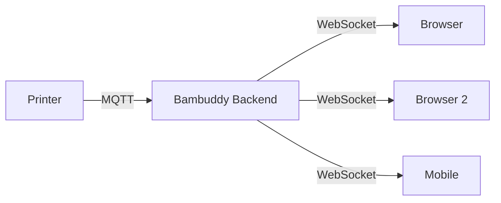

# Мониторинг в реальном времени {#real-time-monitoring}

Bambuddy отслеживает все подключённые принтеры Bambu Lab с обновлением данных в реальном времени через WebSocket.

{ .screenshot }

---

## :material-magnify: Поиск и фильтры {#search-filters}

В больших фермах печати сложно ориентироваться с телефона, где нельзя воспользоваться Ctrl+F. На странице принтеров над сеткой карточек доступны строка поиска в реальном времени и два раскрывающихся фильтра.

### Поиск в реальном времени {#live-search}

Введите запрос в строку поиска, чтобы фильтровать карточки по мере ввода. Поиск проверяет **любое** из следующих полей без учёта регистра и крайних пробелов:

- Название принтера
- Модель принтера (например, `X1C`, `P1S`, `A1 mini`)
- Расположение
- Серийный номер

Чтобы очистить поиск, нажмите кнопку **:material-close:** внутри строки.

### Фильтр по состоянию {#status-filter}

Раскрывающийся список **состояния** фильтрует принтеры по текущему состоянию:

| Вариант | Что показывается |
|--------|-------|
| Все состояния | Все принтеры (по умолчанию) |
| Печатает | Выполняется задание |
| Пауза | Печать приостановлена |
| Ожидание | Подключён и готов к работе |
| Завершено | Ожидает очистки стола |
| Ошибка | Состояние FAILED или активные ошибки HMS |
| Не в сети | Отключён |

Фильтр состояния **реагирует на обновления WebSocket**: когда печать завершается и принтер переходит из `RUNNING` в `FINISH`, он сразу исчезает из представления «Печатает» без обновления страницы вручную.

### Фильтр по расположению {#location-filter}

Список **расположений** появляется, только если хотя бы у одного принтера оно задано. С его помощью можно быстро показать принтеры одной мастерской, стойки или комнаты. Значения берутся непосредственно из настроек каждого принтера.

### Совместное использование фильтров {#combining-filters}

Поиск и фильтры состояния и расположения действуют одновременно: принтер должен соответствовать **всем трём** условиям. Если подходящих принтеров нет, появится сообщение о пустом результате; очистите поиск или сбросьте фильтры, чтобы снова увидеть все принтеры.

!!! tip "Совет для мобильных устройств"
    На телефоне используйте строку поиска, чтобы быстро найти принтер по расположению или серийному номеру вместо прокрутки множества карточек.

---

## :material-resize: Изменение размера карточек принтеров {#resizable-printer-cards}

Настройте размер карточек под экран и свои задачи:

### Размеры карточек {#card-sizes}

| Размер | Описание |
|:----:|-------------|
| **S** (маленький) | Компактный вид, больше карточек в строке. Отображает название, индикатор состояния, прогресс и во время печати оставшееся время, расчётное время завершения и прогресс слоёв |
| **M** (средний) | Сбалансированный вид по умолчанию |
| **L** (большой) | Больше подробностей, меньше карточек в строке. Подписи, значения и значки внутри карточки крупнее на 20% |
| **XL** (очень большой) | Максимум подробностей, одна колонка. Подписи, значения и значки крупнее на 40% |

!!! tip "Крупный текст без увеличения всей страницы"
    В размерах L и XL масштабируются текст и значки самой карточки, а не только её ширина: подписи слотов AMS, температуры и маленькие кнопки растут вместе с карточкой. Размеры S и M не меняются, поэтому обзор фермы остаётся таким же компактным.

### Изменение размера {#adjusting-size}

1. Найдите кнопки **+** и **-** на панели страницы принтеров
2. Нажмите **+**, чтобы увеличить карточки
3. Нажмите **-**, чтобы уменьшить их
4. Выбранный размер сохраняется автоматически

!!! tip "Обзор фермы печати"
    Используйте маленький размер, чтобы одновременно наблюдать за множеством принтеров на большом экране.

---

## :material-chart-bar: Сводная панель состояния {#status-summary-bar}

Панель в верхней части страницы принтеров позволяет с первого взгляда оценить состояние фермы:

### Доступность и количество {#availability-counts}

| Индикатор | Описание |
|:---------:|-------------|
| :material-circle:{ style="color: #4caf50" } **X доступно** | Принтеры в ожидании, готовые принять задание (показываются всегда, даже при 0) |
| :material-circle:{ style="color: #4caf50" } **X печатает** | Принтеры, выполняющие задание (пульсирующая точка) |
| :material-circle:{ style="color: #9e9e9e" } **X не в сети** | Отключённые принтеры |
| :material-circle:{ style="color: #f44336" } **X с проблемами** | Подключённые принтеры с активными ошибками HMS (показываются только при значении > 0) |

### Ближайший доступный принтер {#next-available-printer}

Когда хотя бы один принтер печатает, панель показывает, какой из них освободится раньше:

- **Название принтера** — принтер, который раньше других завершит текущее задание
- **Индикатор прогресса** — наглядное отображение выполнения
- **Процент** — текущий прогресс печати
- **Оставшееся время** — расчётное время до освобождения принтера

!!! tip "Мониторинг фермы печати"
    Индикатор «Ближайший доступный» особенно полезен для больших ферм: он позволяет быстро узнать, какой принтер освободится следующим, не просматривая все карточки.

---

## :material-tab: Ход печати во вкладке браузера {#print-progress-in-the-browser-tab}

Следите за печатью, не переключаясь обратно в Bambuddy. Если функция включена, **заголовок вкладки браузера** показывает прогресс печати, которая завершится раньше всего, а **значок сайта** — кольцо прогресса акцентного цвета темы. Оба используют существующие обновления состояния принтеров.

В разделе **Настройки → Внешний вид** включите **Прогресс печати во вкладке** (по умолчанию выключено), затем выберите **Отображение вкладки**:

| Отображение вкладки | Пример | Описание |
|-------------|---------|-------------|
| **Процент** (по умолчанию) | `42% · Bambuddy` | Как и прежде, показывает процент завершения выбранной печати. |
| **Оставшееся время** | `1h 26m · Bambuddy` или `16m · Bambuddy` | Показывает оставшееся время в том же формате, что и индикатор **Ближайший доступный** на странице принтеров. |

Параметр **Отображение вкладки** появляется, когда включён **Прогресс печати во вкладке**. Его можно изменить в любой момент; кольцо значка сайта в обоих режимах продолжает показывать **процент**.

| Поведение | Подробности |
|-----------|--------|
| **Какая печать** | Выполняющаяся печать, которая завершится раньше всех среди всех принтеров (как для индикатора [Ближайший доступный](#next-available-printer)); при равном времени выбирается больший прогресс. |
| **Оставшееся время неизвестно** | До получения достоверной оценки показывается процент печати. |
| **При простое** | Когда печать не выполняется, восстанавливаются исходные заголовок и значок вкладки. |
| **Область действия** | Оба параметра сохраняются **для каждого браузера отдельно** (`localStorage`) и не синхронизируются с сервером или другими устройствами. |
| **В фоновой вкладке** | Обновления продолжают поступать с учётом ограничения фоновых вкладок браузером — см. примечание ниже. |

!!! tip "Фоновый мониторинг"
    Закрепите вкладку Bambuddy и включите эту функцию, чтобы видеть прогресс или оставшееся время ближайшей печати, работая в других вкладках.

!!! note "Частота обновления при просмотре другой вкладки"
    Браузеры намеренно замедляют фоновые вкладки для экономии энергии: таймеры ограничиваются примерно одним срабатыванием в секунду, а после пяти минут в скрытой вкладке — примерно одним в минуту. Поэтому процент или оставшееся время обновляются скачками и наверстают пропущенное, как только вы вернётесь на вкладку. Это правило браузера действует для всех сайтов; Bambuddy не может его отменить. Если нужен непрерывный просмотр, держите вкладку видимой — на втором мониторе или в отдельном окне.

---

## :material-monitor-dashboard: Состояние принтера {#printer-status}

На каждой карточке принтера показывается информация в реальном времени:

### Состояние подключения {#connection-status}

| Индикатор | Состояние |
|:---------:|--------|
| :material-circle:{ style="color: #4caf50" } | Подключён, обмен данными идёт |
| :material-circle:{ style="color: #ff9800" } | Подключение или повторное подключение |
| :material-circle:{ style="color: #f44336" } | Отключён или произошла ошибка |

### Показания температуры {#temperature-readouts}

Текущие температуры обновляются каждые несколько секунд:

| Датчик | Описание |
|--------|-------------|
| :material-printer-3d-nozzle: **Сопло** | Текущая температура хотэнда |
| :material-radiator: **Стол** | Температура подогреваемого стола |
| :material-home-thermometer: **Камера** | Температура камеры, если доступна |

### История нагревателей {#heater-history}

На каждой плитке нагревателя в карточке принтера есть небольшой значок графика в правом верхнем углу. Нажмите на саму плитку, чтобы открыть окно целевой температуры, или на значок графика, чтобы открыть историю соответствующего датчика.

Bambuddy записывает показания сопла, стола и камеры каждые 60 секунд вместе с соответствующей целевой температурой, чтобы после печати можно было изучить изменение температуры:

| Элемент | Описание |
|---------|-------------|
| **Выбор типа** | Сопло / Сопло 2 (двойное сопло H2D) / Стол / Камера — показаны только датчики этой модели. |
| **Диапазон времени** | Выбор периода 6 ч / 24 ч / 48 ч / 7 дней. |
| **Карточки статистики** | Текущее значение со стрелкой тенденции, среднее, минимум и максимум за выбранный период. |
| **График** | Сплошная линия показывает измерения, пунктирная ступенчатая — заданную целевую температуру. |

!!! info "Камеры только с датчиком"
    Для камер X1C и P2S, где доступен только датчик и команда нагрева `M141` не принимается, значок графика тоже работает: Bambuddy считывает датчик камеры, поэтому история помогает заметить отклонения и настроить условия окружающей среды.

#### Срок хранения {#retention}

По умолчанию данные нагревателей хранятся 30 дней. При необходимости измените срок в **Настройки → Филамент → Хранение истории → Хранить историю температур принтера (сопло, стол, камера)** (1–365 дней). Старые записи автоматически удаляются циклом записи примерно раз в 24 часа.

### Данные сопел (серия H2) {#nozzle-details-h2-series}

Принтеры серии H2 показывают расширенные сведения о соплах при наведении:

| Принтер | Возможность | Подробности |
|---------|---------|---------|
| **H2D / H2D Pro** | Карточка левого и правого сопла | Показывает данные обоих сопел рядом: диаметр, тип, поток, износ, максимальную температуру и серийный номер. Активное сопло выделено состоянием «Активно»/«Ожидание». |
| **H2S** | Карточка одного сопла | При наведении на карточку температуры показывает расширенные сведения о сопле: износ, серийный номер и максимальную температуру. |
| **H2C** | Карточка стойки сопел | Док смены инструментов на шесть позиций показывает все слоты стойки с диаметром и цветом филамента; нумерация 1–6 соответствует физическому положению. Пустые слоты сохраняют номер и отображаются как заглушки. Для подробностей наведите курсор. |

!!! info "Состояние левого и правого сопла"
    Карточка показывает **Активно** или **Ожидание** в зависимости от того, какое сопло принтер использует сейчас, а не от состояния установки или парковки.

### Состояние вентиляторов {#fan-status}

В разделе управления скорость вентиляторов отслеживается в реальном времени:

| Вентилятор | Значок | Цвет | Описание |
|-----|:----:|:-----:|-------------|
| :material-fan: **Обдув детали** | Вентилятор | Голубой | Охлаждает печатаемые слои |
| :material-weather-windy: **Дополнительный** | Ветер | Синий | Управляет потоком воздуха в камере. На X2D — **левый дополнительный** |
| :material-weather-windy: **Левый дополнительный** | Ветер | Индиго | Второй вентилятор обдува детали (P2S, если установлен). На X2D — **правый дополнительный** |
| :material-air-filter: **Камера** / **Вытяжка** | Вентиляция | Зелёный | Выводит горячий воздух из корпуса |

!!! info "Дополнительные вентиляторы P2S / X2D"
    Второй дополнительный вентилятор и значок **Вытяжка** появляются, только когда принтер сообщает об их наличии: для P2S это дополнительные комплекты, а для X2D — заводское оснащение. На этих моделях вентилятор корпуса называется **Вытяжка**, а на остальных закрытых моделях — **Камера**.

Цвет значков вентиляторов меняется в зависимости от состояния:

- **Активен** (цветной): вентилятор работает, показана текущая скорость в %
- **Неактивен** (серый): вентилятор выключен, показано 0%

В этой же строке отображается **значок скорости печати** (:material-gauge:) с процентом текущего режима скорости. Подробнее см. [Управление принтером > Скорость печати](printer-control.md#print-speed-control).

Скорость вентиляторов обновляется в реальном времени через WebSocket вместе с температурой.

### Индикатор состояния в компактном режиме {#compact-mode-status-pip}

В компактном режиме (S) на каждой карточке отображается небольшая цветная точка состояния:

| Цвет | Значение |
|:-----:|---------|
| :material-circle:{ style="color: #4caf50" } Зелёный | Подключён, проблем нет |
| :material-circle:{ style="color: #f44336" } Красный | Не в сети либо есть ошибка HMS, остановившая или приостановившая печать (уровень **Error** или **Warning**) |
| :material-circle:{ style="color: #ff9800" } Оранжевый | Есть только ошибки HMS, не останавливающие печать (уровень **Notice** или уровень не указан принтером) |

Наведите курсор на индикатор, чтобы увидеть число активных ошибок HMS.

### Показатели в компактном режиме {#compact-mode-metrics}

Во время печати маленькая карточка также показывает строку показателей под индикатором прогресса:

- **Оставшееся время** (:material-clock-outline:) — например, `1h 23m`
- **Расчётное время завершения** — время на часах в выбранном формате 12/24 часа
- **Прогресс по слоям** (:material-layers-triple:) — например, `120/267`

Если принтер не сообщает отдельные значения, они не показываются; когда печать не идёт, строка пуста. При этом её высота сохраняется, чтобы карточки не смещались при начале и завершении печати.

!!! tip "Какой принтер закончит первым"
    Благодаря расчётному времени завершения маленькие карточки можно использовать на настенном экране: всю ферму легко сравнить одним взглядом. Нажатие на маленькую карточку открывает подробности: сетка переключается на средний размер и прокручивается к принтеру; кнопка **Назад** позволяет вернуться.

### Ход печати {#print-progress}

Во время печати отображаются:

- **Индикатор прогресса** — процент выполнения; при паузе становится оранжевым
- **Текущий слой** — слой X из Y
- **Оставшееся время** — расчётное время до завершения
- **Израсходованный филамент** — уже израсходованное количество в граммах
- **Следующая пауза** (:material-pause:, синий) — если в слайсере добавлена пауза, показываются время до неё и время на часах, например `20m to pause · 20:27`. Наведите курсор, чтобы увидеть слой. При нескольких паузах отсчитывается время до ближайшей, затем — до следующей. Пока принтер не сообщил оставшееся время, а также в режиме скорости, отличном от стандартного, показывается только слой. Индикатор доступен на карточках размера M и больше.

!!! note "Откуда берётся время паузы"
    Bambuddy считывает паузы из G-кода печати в архивном 3MF: Bambu Studio и OrcaSlicer записывают паузу как `M400 U1` в начале заданного слоя и указывают оставшееся в этот момент время. Обратный отсчёт равен оставшемуся времени принтера за вычетом этого значения. Время слайсера рассчитано для стандартной скорости, поэтому в режимах Silent, Sport и Ludicrous карточка показывает слой паузы вместо времени, а уведомление о предстоящей паузе не отправляется. Для печатей без архивного 3MF, например если Bambuddy не смог его скачать, время паузы не показывается.

    Чтобы получать предупреждение перед паузой, включите [уведомление о предстоящей паузе](notifications.md#print-events) для канала уведомлений.

### Сортировка по состоянию {#status-sorting}

При сортировке по состоянию принтеры располагаются в порядке приоритета:

1. **Ошибки HMS** — принтеры с активными ошибками HMS в начале
2. **Печатает** — принтеры, выполняющие задание
3. **Ожидание** — подключены, активного задания нет
4. **Не в сети** — отключённые принтеры

Это помогает быстро найти принтеры, требующие внимания, в больших фермах.

### Сортировка по времени завершения {#eta-sorting}

При сортировке по **времени завершения** принтер, который освободится следующим, отображается первым. Это удобно для предварительной подготовки филамента следующего задания:

1. **Печатают с известным временем завершения** — сначала ближайшее завершение, по возрастанию оставшихся минут
2. **Печатают без оценки времени** — короткий период между запуском печати и сообщением общего времени слайсером
3. **Ожидание / завершено** — подключены, активного задания нет
4. **Не в сети** — отключены

Принтеры с одинаковой оценкой времени или без активной печати сортируются по алфавиту, чтобы список оставался стабильным при обновлении. Кнопка направления сортировки переворачивает результат: по убыванию отключённые принтеры оказываются вверху, что удобно для проверки связи по всей ферме.

Сортировка по времени завершения показывает плоский список без заголовков разделов, поскольку время каждого принтера уникально.

### Сворачиваемые группы {#collapsible-groups}

При сортировке по **состоянию**, **модели** или **расположению** принтеры выводятся в сворачиваемых разделах: нажмите заголовок, чтобы развернуть или свернуть группу. Сортировка по **названию** и **времени завершения** показывает плоскую сетку.

- Состояние каждой группы сохраняется при обновлении страницы отдельно в браузере (`localStorage`).
- В режиме выбора каждый заголовок раздела содержит кнопку **Выбрать все**, которая выбирает все принтеры группы.
- Группы состояний идут по приоритету (ошибка → печатает → пауза → завершено → ожидание → не в сети); переключатель направления меняет порядок на обратный.

---

## :material-alert-decagram: Мониторинг ошибок HMS {#hms-error-monitoring}

Health Management System (HMS) следит за состоянием принтера и показывает проблемы в реальном времени.

### Индикатор состояния {#status-indicator}

Индикатор HMS всегда виден на карточке принтера:

| Состояние | Значение | Действие |
|:------:|---------|--------|
| :material-check-circle:{ style="color: #4caf50" } **OK** | Учитываемых ошибок нет | Не требуется |
| :material-alert:{ style="color: #ff9800" } Оранжевый, с числом | Только учитываемые сообщения уровня **Notice**, например запрос, ожидающий вашего действия; печать продолжается | Проверьте, когда удобно |
| :material-alert-circle:{ style="color: #f44336" } Красный, с числом | Как минимум одна ошибка **Error** (печать остановлена) или **Warning** (печать приостановлена) | Требуется внимание |

Используются уровни, которые сообщает сам принтер и которые также применяются в Bambu Studio и Bambu Handy.

### Подробности ошибки {#error-details}

Нажмите индикатор HMS, чтобы увидеть:

- Опубликованное Bambu описание ошибки для модели принтера. Тексты берутся из файлов HMS Bambu Studio и охватывают около 6400 кодов. Они приведены на английском языке.
- Код в том виде, в каком он показан на экране принтера, например `0500-0300-0002-000E`
- Уровень: **Error**, **Warning** или **Notice**
- Предлагаемые Bambu кнопки действий, если они есть (см. ниже)
- Ссылку на Wiki HMS Bambu Lab

Два вида сообщений не учитываются в индикаторе, значке проблем на карточке и стене камер и не вызывают уведомлений:

- **Уведомления, не требующие вашего участия.** Сообщения уровня **Notice** из списка HMS принтера без кнопок действий, например «Открыта верхняя крышка» или «Температура камеры высока, система увеличила скорость вентилятора». Принтер может сохранять их на протяжении всей печати.
- **Коды без опубликованного текста.** Для некоторых кодов Bambu оставляет описание пустым, а некоторые вообще отсутствуют в списке.

Они всё равно перечисляются в диалоговом окне с текстом, если Bambu его предоставила, в свёрнутом разделе **Также сообщено, не учитывается**; таким образом, ни одно сообщение принтера не скрывается. Ошибка с кнопками действий всегда учитывается, поэтому её кнопки отображаются.

### Действия при ошибках (возобновить / остановить / помощник проверки / …) {#error-actions-resume-stop-check-assistant}

Для каждой ошибки в окне показываются те же кнопки действий, что и в Bambu Studio и Bambu Handy: **Возобновить печать**, **Остановить печать**, **Продолжить**, **Повторить**, **Филамент выдавлен**, **Помощник проверки**, **Больше не напоминать**, **Проверить снова** и другие в зависимости от каталога Bambu для данной ошибки и модели принтера.

При нажатии кнопки Bambuddy отправляет принтеру соответствующую команду MQTT. Формат сообщений повторяет исходный код `DeviceErrorDialog` / `DeviceManager` Bambu Studio, поэтому принтер получает одинаковые данные независимо от клиента:

- **Возобновить печать / Возобновить (дефекты допустимы) / Возобновить (проблема решена) / Проблема решена и возобновить / Филамент загружен, возобновить / Продолжить** → команда `resume`. Она сообщает прошивке: «Проблема решена, выполните обычную повторную проверку и продолжайте». Если при возобновлении ошибка возникает снова, например из-за действительно неверного стола, принтер обнаружит её повторно и снова приостановится с тем же кодом. Для пропуска такой проверки используйте **Игнорировать и продолжить**.
- **Игнорировать и продолжить / Игнорировать. Не напоминать в следующий раз / Больше не напоминать** → команда `ignore`. В отличие от возобновления, она одной операцией сообщает прошивке: «Пропустите следующую повторную проверку этой ошибки и возобновите печать». Поле `err` содержит десятичное целое значение кода ошибки (как в формате Bambu Studio), а `job_id` — ID активного подзадания, чтобы прошивка знала, проверку какой печати пропустить.
- **Не напоминать в следующий раз** → `idle_ignore` с `type=0`. Закрывает диалог на сенсорном экране принтера без возобновления; прошивка один раз подавляет повторный показ предупреждения.
- **Остановить печать** → команда `stop`. Прерывает приостановленную печать, и принтер переходит в состояние FAILED.
- **Филамент выдавлен / Продолжить / Повторить / Прервать** (диалоги загрузки филамента) → `ams_control` с `param=done` / `resume` / `abort`.
- **OK / Подтвердить** → `clean_print_error` (та же команда, что используется кнопкой «Очистить ошибки»).
- **Помощник проверки**, **Просмотр камеры**, **Закрыть**, **Отмена** — показаны для соответствия диалогу Bambu Studio, но не имеют аналога MQTT; ими управляет сенсорный экран принтера. Bambuddy показывает те же подписи, но нажатие не отправляет сетевую команду.

После нажатия Bambuddy до 2,5 секунды ждёт хотя бы одного обновления состояния по MQTT от принтера. Если обновление не пришло, выводится **`Printer did not acknowledge HMS action`**, а не сообщение об успехе. Это позволяет заметить незаметный отказ прошивки: брокер подтвердил публикацию, но принтер отбросил команду, например из-за неверного формата `err`.

Набор кнопок определяется моделью принтера (`X1C`, `P1S`, `A1`, `H2D`, …) и кодом ошибки по опубликованному каталогу HMS Bambu. Если в каталоге нет действий для кода, диалог показывает только описание ошибки и резервную кнопку «Очистить ошибки».

Названия действий переведены на все 13 поддерживаемых языков: английский, немецкий, испанский, французский, итальянский, японский, корейский, португальский (Бразилия), русский, турецкий, украинский, упрощённый и традиционный китайский.

!!! note "Требуется разрешение"
    Для действий HMS необходимо разрешение **Управление принтером** (`printers:control`). Без него пользователь не сможет выполнять действия.

### Очистка ошибок {#clear-errors}

Внизу окна ошибок HMS также есть кнопка **Очистить ошибки**, которая:

1. Отправляет принтеру команду `clean_print_error` через MQTT
2. Немедленно удаляет ошибки из интерфейса Bambuddy
3. Появляется, когда у принтера есть любая ошибка, включая ошибки без описания

Это позволяет скрыть устаревшие значения `print_error`, сохраняющиеся после отмены печати или кратковременных событий, без выключения и повторного включения принтера или запуска новой печати. Кнопки отдельных ошибок выше обрабатывают типичные случаи, а очистка ошибок служит универсальным вариантом для старых кодов без сопоставленных действий.

!!! note "Требуется разрешение"
    Кнопка очистки требует разрешения **Управление принтером** (`printers:control`). Без него кнопка отображается неактивной.

!!! tip "Уведомления HMS"
    Включите уведомления об ошибках HMS, чтобы сразу узнавать о проблемах. См. [Уведомления](notifications.md).

---

## :material-access-point: Уровень сигнала Wi-Fi {#wifi-signal-strength}

На карточке принтера показывается уровень сигнала Wi-Fi:

| Значок | Сигнал |
|:----:|--------|
| :material-wifi-strength-4: | Отличный |
| :material-wifi-strength-3: | Хороший |
| :material-wifi-strength-2: | Удовлетворительный |
| :material-wifi-strength-1: | Слабый |

Слабый сигнал может вызывать разрывы связи и проблемы мониторинга печати.

---

## :material-timer-sand: Общее время печати {#total-print-hours}

Отслеживайте суммарное время печати каждого принтера:

- Отображается на карточке принтера
- Полезно для планирования обслуживания
- Помогает определить интенсивно используемые устройства

---

## :material-bug: Отладочное журналирование MQTT {#mqtt-debug-logging}

Встроенный инструмент отладки связи с принтером:

### Запуск отладочной записи {#starting-debug-logging}

1. Нажмите значок настроек на карточке принтера
2. Нажмите **Отладка MQTT**, затем **Начать запись**
3. Сообщения записываются в реальном времени

### Просмотр сообщений {#viewing-messages}

| Направление | Описание |
|-----------|-------------|
| :material-arrow-down: **Входящие** | Сообщения от принтера в Bambuddy |
| :material-arrow-up: **Исходящие** | Команды, отправленные принтеру |

Возможности:

- **Данные JSON** — разворачиваются для подробного просмотра
- **Фильтр по типу** — позволяет сосредоточиться на нужных типах сообщений
- **Поиск** — поиск определённого содержимого
- **Автообновление** — новые сообщения появляются автоматически

### Примеры использования {#use-cases}

- Устранение проблем с подключением
- Анализ поведения принтера
- Отладка проблем автоматизации
- Сообщение о проблемах разработчикам

---

## :material-web: Архитектура WebSocket {#websocket-architecture}

Bambuddy использует WebSocket для обновлений в реальном времени:

### Как это работает {#how-it-works}

1. **Принтер** отправляет обновления состояния через MQTT поверх TLS
2. **Бэкенд** обрабатывает и сохраняет данные
3. **WebSocket** рассылает обновления всем подключённым клиентам
4. **Браузер** немедленно обновляет интерфейс

### Особенности подключения {#connection-features}

| Возможность | Описание |
|---------|-------------|
| **Автоматическое переподключение** | При разрыве соединение восстанавливается автоматически |
| **Синхронизация состояния** | При повторном подключении синхронизируется всё состояние |
| **Инкрементальные обновления** | Передаются только изменившиеся данные |
| **Несколько вкладок** | Поддерживаются несколько вкладок браузера |

### Производительность {#performance}

- **Задержка**: обычно < 1 секунды
- **Трафик**: минимальный, передаются только изменения
- **Масштабируемость**: поддерживается несколько клиентов

---

## :material-folder: Обозреватель файлов принтера {#printer-file-browser}

Просматривайте файлы во внутреннем хранилище принтера и управляйте ими.

### Открытие обозревателя файлов {#opening-the-file-browser}

1. Нажмите значок папки (:material-folder:) на любой карточке принтера
2. Откроется окно с файловой системой принтера

### Навигация {#navigation}

- **Кнопки быстрого доступа** — переход в корневой каталог, Cache, Models или Timelapse
- **Путь навигации** — текущее расположение с возможностью возврата
- **Нажатие на папку** — переход во вложенный каталог

### Выбор файлов {#file-selection}

Выберите файлы для групповых операций:

| Действие | Описание |
|--------|-------------|
| **Нажать флажок** | Выбрать отдельный файл или снять выбор |
| **Выбрать все** | Выбрать все файлы в текущем представлении |
| **Снять выделение** | Снять все отметки |

### Операции с файлами {#file-operations}

| Операция | Один файл | Несколько файлов |
|-----------|------------|----------------|
| **Скачать** | Прямое скачивание | Скачивание в ZIP-архиве |
| **Удалить** | Удаление с подтверждением | Групповое удаление с подтверждением |

### Сортировка и фильтрация {#sorting-filtering}

| Элемент | Варианты |
|---------|---------|
| **Сортировка** | Название (A–Z/Z–A), размер, дата |
| **Фильтр** | Введите имя файла для фильтрации списка |

### Информация о хранилище {#storage-info}

В заголовке показываются занятое и свободное место, если эти данные доступны.

---

## :material-image-multiple: Изображения принтеров {#printer-images}

Добавьте изображения на карточки принтеров:

1. Нажмите значок настроек на карточке принтера
2. Загрузите изображение принтера
3. Изображение появится на карточке

!!! tip "Рекомендуемый размер"
    Для наилучшего результата используйте изображения около 300×200 пикселей.

---

## :material-bell-ring: Уведомления об изменении состояния {#status-change-notifications}

Настройте оповещения о событиях принтера:

| Событие | Описание |
|-------|-------------|
| **Принтер не в сети** | При потере соединения |
| **Ошибка принтера** | При возникновении ошибок HMS |
| **Печать завершена** | При завершении задания |
| **Ошибка печати** | При неудачной печати |

[:material-arrow-right: Настроить уведомления](notifications.md)

---

## :material-lightbulb: Советы {#tips}

!!! tip "Мониторинг с первого взгляда"
    Держите страницу принтеров открытой на отдельном экране или планшете для постоянного наблюдения.

!!! tip "Проверка по камере"
    Используйте страницу камеры, чтобы наряду с данными состояния визуально оценивать качество печати.

!!! tip "Раннее обнаружение ошибок"
    Включите уведомления об ошибках HMS, чтобы обнаруживать проблемы до того, как они испортят печать.

!!! tip "Отладка при необходимости"
    Если принтер ведёт себя неожиданно, проверьте журналы отладки MQTT: они часто помогают найти проблемы связи.
